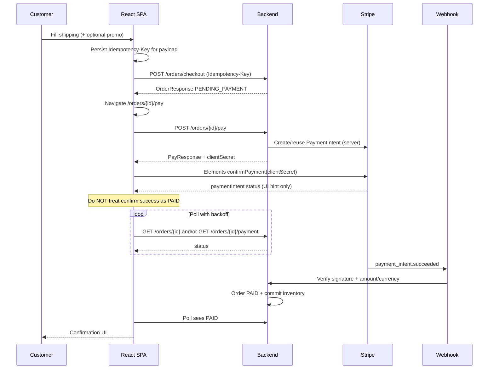

# Phase 7 WP-C Implementation Plan — Checkout & Stripe Elements

**Date:** 2026-11-05  
**Status:** **Approved — implementation in progress**  
**Depends on:** WP-A + WP-B approved; Phase 6 payment architecture complete  
**Parent plan:** `docs/PHASE7_IMPLEMENTATION_PLAN.md` (P7-D1…D15; workflow §10.1)  
**Prior reports:** `docs/PHASE7_WP_B_COMPLETION_REPORT.md`, `docs/PHASE6_COMPLETION_REPORT.md`  
**Workflow note:** After WP-C verification + completion report, continue WP-D…G automatically (no separate approval gates).

---

## 0. Scope statement

### In scope (WP-C only)

| Area | Intent |
|------|--------|
| Checkout UI | Shipping address form → `shippingAddressJson`; optional promotion code |
| Order summary | Display **backend** cart/order money fields only (no FE total math as authority) |
| Checkout API | `POST /orders/checkout` with `Idempotency-Key` + recovery |
| Pay step | `POST /orders/{id}/pay` → Stripe Elements (`clientSecret`) |
| Confirmation | Poll order/payment until backend reports `PAID` / terminal unpaid |
| Customer orders | List + detail + unpaid cancel + payment status display |
| Auth | CUSTOMER-only; ADMIN blocked (P7-D2-A) |
| Stripe | Test Mode publishable key only (`VITE_STRIPE_PUBLISHABLE_KEY`, P7-D6-A) |

### Out of scope

| Item | Notes |
|------|-------|
| Stripe Live Mode / production deploy | Forbidden |
| Creating PaymentIntents from the frontend | Forbidden — backend `/pay` only |
| Storing `sk_*` / card PAN / CVV | Forbidden |
| Treating `confirmPayment()` as order `PAID` | Webhook remains sole authority |
| Guest checkout | No guest carts (WP-B invariant) |
| Address book | Rejected (P7-D3-A) |
| Admin dashboard / shipping fulfillment / refund UI | WP-D / WP-E / WP-F |
| Playwright full-suite CI | WP-G (local Stripe CLI checklist in WP-C) |
| New backend APIs / migrations | Not without approval |
| Redux / TanStack Query | Forbidden (P7-D8-A) |

### Stop / continue condition (workflow revised 2026-11-05)

1. Finish WP-C implementation, verification (`npm test` / build / lint / audit + Stripe CLI checklist), and `docs/PHASE7_WP_C_COMPLETION_REPORT.md`.  
2. **Do not** start WP-D before those WP-C checks pass.  
3. After WP-C passes: **continue automatically** into WP-D → WP-E → WP-F → WP-G per parent plan §10.1 (internal packages only; not approval gates).  
4. Stop and request approval only for critical blockers or Phase 1–6 / scope-expanding changes.

---

## 1. Current architecture (inspected)

### 1.1 Backend money path (Phase 5–6)

```text
Cart (CUSTOMER)
  → POST /orders/checkout (+ Idempotency-Key)
      → Order PENDING_PAYMENT, stock reserved, cart cleared
  → POST /orders/{id}/pay
      → PaymentIntent created/reused; response includes clientSecret
  → Stripe Elements confirmPayment (frontend)
  → Stripe webhook POST /payments/webhook/stripe (backend only)
      → PENDING_PAYMENT → PAID + inventory commit once
```

Frontend never talks to the webhook endpoint.

### 1.2 Frontend baseline (WP-A / WP-B)

| Piece | State |
|-------|--------|
| Stack | React 18.3, RR 7.18.5, Vite 6.4.5, Tailwind 3.4, Vitest 4.1.12 |
| Auth | Access in memory; refresh in `sessionStorage`; single-flight refresh |
| Guards | `CustomerRoute` for cart/checkout/orders; ADMIN denied |
| API | `apiRequest` + typed models; `headers` already supported |
| Stripe packages | **Not installed yet** (`@stripe/stripe-js`, `@stripe/react-stripe-js`) |
| Env | `VITE_STRIPE_PUBLISHABLE_KEY` + `assertStripeTestPublishableKey` already in `env.ts` |
| Routes | `/checkout`, `/orders`, `/orders/:id` are placeholders |
| Cart | Full CRUD; note that checkout re-prices from catalog |
| Promo UI | Not in WP-B; checkout body still accepts `promotionCode` |

### 1.3 Locked Phase 7 decisions that apply

| ID | Implication for WP-C |
|----|----------------------|
| P7-D2-A | ADMIN cannot use cart/checkout/pay |
| P7-D3-A | Shipping collected at checkout as JSON string; no address book |
| P7-D6-A | Publishable key via Vite env only |
| P7-D8-A | Lightweight fetch state; no Redux/TanStack Query |
| P7-D11 | Preserve token storage model |

---

## 2. API contract (verified — do not invent fields)

All paths under `/api/v1`. Enveloped as `ApiResponse` / error body with `code`, `message`, optional `fieldErrors`.

### 2.1 Checkout

| | |
|--|--|
| **Method / path** | `POST /orders/checkout` |
| **Auth** | `CUSTOMER` and not `ADMIN` |
| **Header** | `Idempotency-Key` **required** (non-blank, ≤128 chars) |
| **Body** | `CheckoutRequest` (optional; null body treated as empty) |

```json
{
  "promotionCode": "SAVE10",
  "shippingAddressJson": "{\"line1\":\"123 Main\",\"city\":\"Austin\",\"region\":\"TX\",\"postalCode\":\"78701\",\"country\":\"US\",\"fullName\":\"Ada Lovelace\"}"
}
```

| Field | Backend rules |
|-------|---------------|
| `promotionCode` | `@Size(max=64)`; blank → no promo; normalized UPPER+trim for idempotency hash |
| `shippingAddressJson` | Free-form string; blank → stored as null; **no schema validation** on server |

**Success (201):** `OrderResponse`

| Field | Notes |
|-------|-------|
| `id`, `orderNumber`, `userId` | Identifiers |
| `status` | `PENDING_PAYMENT` on create |
| `subtotalCents`, `discountCents`, `taxCents`, `totalCents` | Server-authoritative (`taxCents` always 0 today) |
| `currency` | From products |
| `shippingAddressJson` | Echo of stored string |
| `promotionId`, `promotionCode` | Nullable |
| `items[]` | `id`, `productId`, `productName`, `sku`, `unitPriceCents`, `quantity`, `lineTotalCents` |
| `createdAt`, `updatedAt` | Instants |

**Idempotency fingerprint** (`CheckoutIdempotencyHasher`):

```text
SHA-256( UTF-8(
  "v1\n"
  "promotionCode=<UPPER TRIM or empty>\n"
  "shippingAddressJson=<TRIM or empty>\n"
) )
```

Cart contents are **not** in the fingerprint (cart is server-owned; first success clears cart).

| Same key + same hash | Replay original `OrderResponse` |
| Same key + different hash | **409** `IDEMPOTENCY_KEY_CONFLICT` |
| Missing/blank/too-long key | **400** `IDEMPOTENCY_KEY_REQUIRED` |

**Other checkout errors:**

| Code | HTTP | When |
|------|------|------|
| `CART_EMPTY` | 400 | No cart / empty items |
| `PRODUCT_NOT_AVAILABLE` | 409 | Inactive/deleted product |
| `INSUFFICIENT_STOCK` | 409 | Reserve fails |
| `CURRENCY_MISMATCH` | 409 | Mixed currencies |
| Promo failures | (existing promotion codes) | Invalid / inapplicable code |

Checkout **re-prices from Catalog** (ignores cart unit prices). Cart clears only after successful create.

### 2.2 Orders (customer)

| Method | Path | Behavior |
|--------|------|----------|
| `GET` | `/orders?page&size` | Own history → `PageResponse<OrderResponse>` |
| `GET` | `/orders/{orderId}` | Own detail |
| `POST` | `/orders/{orderId}/cancel` | Only `PENDING_PAYMENT`; releases stock + restores promo once |

Cancel errors: `ORDER_CANCEL_NOT_ALLOWED`, `ORDER_NOT_FOUND`, etc.

### 2.3 Pay + payment reads

| Method | Path | Response |
|--------|------|----------|
| `POST` | `/orders/{orderId}/pay` | `PayResponse` **includes `clientSecret`** |
| `GET` | `/orders/{orderId}/payment` | `PaymentResponse` — **no `clientSecret`** |
| `GET` | `/payments/{paymentId}` | Same view (own or ADMIN) — **no `clientSecret`** |

**`PayResponse`:** `id`, `orderId`, `status`, `amountCents`, `currency`, `providerRef`, `clientSecret`  
(`toString` deliberately omits `clientSecret`.)

**`PaymentResponse`:** `id`, `orderId`, `userId`, `status`, `amountCents`, `currency`, `providerRef`, `createdAt`, `updatedAt`

**Pay rules (Phase 6):**

- Allowed only while order is `PENDING_PAYMENT`.
- Amount/currency taken from **order totals**, never client.
- Server idempotency key = `pay:{orderId}` — FE does **not** send a pay Idempotency-Key.
- Duplicate/concurrent pay **reuses** active PaymentIntent (retrieves `clientSecret`).
- `PAYMENT_FAILED` / `CANCELLED` / `PAID` → **409** `ORDER_NOT_PAYABLE` (no re-pay; new checkout required).
- Provider outage → **502** `PAYMENT_PROVIDER_UNAVAILABLE`.

**Payment statuses (domain):**  
`PENDING_CREATE`, `REQUIRES_ACTION`, `PENDING`, `CANCEL_REQUESTED`, `CANCELED`, `FAILED`, `SUCCEEDED`, `SUCCEEDED_NEEDS_REFUND`, `CREATE_FAILED`.

**Order statuses relevant to UI:**  
`PENDING_PAYMENT`, `PAID`, `PAYMENT_FAILED`, `CANCELLED` (fulfillment statuses exist but WP-E owns UX polish).

### 2.4 Promo preview (optional checkout aid)

| Method | Path | Body |
|--------|------|------|
| `POST` | `/cart/promo` | `{ "code": "…" }` (CUSTOMER; uses cart subtotal) |
| `POST` | `/promotions/validate` | `{ "code", "subtotalCents" }` |

**`PromotionPreviewResponse`:** `code`, `subtotalCents`, `discountCents`, `taxCents`, `totalCents`, `applicable`.

Preview is **advisory**. Authoritative discount is applied only inside checkout.

### 2.5 Webhook (backend only — FE must not call)

`POST /payments/webhook/stripe` — signature verified; amount/currency checked; sole path to `PAID`.

### 2.6 Missing backend capabilities

| Capability | Status | WP-C action |
|------------|--------|-------------|
| Structured shipping DTO / validation | **Missing** — free-form JSON string only | FE builds form → serialize string; document that backend does not validate fields |
| Dedicated “payment history” list API | **Missing** | Use `GET /orders` + per-order `GET /orders/{id}/payment` |
| Push / SSE payment updates | **Missing** | Client polling with backoff |
| Public stock quantity on PDP | Missing (WP-B known) | Unchanged; stock errors surface at checkout |
| Return `clientSecret` on GET payment | Intentionally omitted | Recovery must call `POST /pay` again |
| Guest checkout | Not supported | Require CUSTOMER login |

**No new backend APIs proposed for WP-C.** If product later requires server-side address validation, that is a separate approval.

---

## 3. Proposed frontend routes and components

### 3.1 Routes

| Route | Guard | Page |
|-------|-------|------|
| `/checkout` | `CustomerRoute` | Shipping + promo + summary → place order |
| `/orders` | `CustomerRoute` | Order / payment history list |
| `/orders/:id` | `CustomerRoute` | Confirmation / detail / cancel unpaid / resume pay |
| `/orders/:id/pay` | `CustomerRoute` | Stripe Elements pay step |

Replace WP-B placeholders. Wire Cart “Checkout” CTA → `/checkout`.

Keep ADMIN nav free of checkout/cart/pay (already).

### 3.2 Feature layout

```text
frontend/src/features/
  checkout/
    api/checkoutApi.ts
    api/paymentApi.ts
    lib/idempotency.ts          # key generate + sessionStorage persistence
    lib/shippingAddress.ts      # form ↔ shippingAddressJson
    lib/paymentPolling.ts       # poll helpers
    components/ShippingAddressForm.tsx
    components/CheckoutSummary.tsx
    components/PromoCodeField.tsx
    components/StripePaymentForm.tsx
    components/PaymentStatusPanel.tsx
    pages/CheckoutPage.tsx
    pages/PayOrderPage.tsx
  orders/
    api/ordersApi.ts
    components/OrderListItem.tsx
    components/OrderDetailPanel.tsx
    pages/OrdersPage.tsx
    pages/OrderDetailPage.tsx
shared/types/
  order.ts
  payment.ts
  promotion.ts
```

Reuse: `formatMoney` / money helpers, `EmptyState` / `ErrorState` / `LoadingState` / `Skeleton`, `CustomerLayout`, `apiRequest`, `CustomerRoute`.

### 3.3 Packages to add (implementation time only)

| Package | Purpose |
|---------|---------|
| `@stripe/stripe-js` | `loadStripe(pk_test_…)` |
| `@stripe/react-stripe-js` | `Elements`, `PaymentElement` / `CardElement` |

Pin compatible versions at install; run `npm audit`. Do **not** add Redux/TanStack Query or unrelated upgrades.

---

## 4. Checkout and payment sequence



---

## 5. Idempotency and recovery strategy

### 5.1 Checkout Idempotency-Key

| Rule | Behavior |
|------|----------|
| Generate | `crypto.randomUUID()` (or equivalent) when starting a **new** checkout attempt |
| Scope | Persist in `sessionStorage` keyed by normalized payload fingerprint (promo + shipping JSON string after FE normalization) |
| Retry uncertain | Network timeout, abort, 5xx, offline — **reuse same key + same body** |
| Payload change | New shipping/promo → **new key** (old key must not be reused) |
| Conflict `IDEMPOTENCY_KEY_CONFLICT` | Show error; force new attempt with new key |
| Success replay | Same key + same body returns original order → navigate to that order’s pay/detail |
| Empty cart after success | Expected; “Place order” again without items → `CART_EMPTY` |

Do **not** put cart line contents into the key material beyond what the server hashes (promo + shipping only).

### 5.2 Pay retry

- `POST /pay` is safe to retry for the same `PENDING_PAYMENT` order (server reuses PI).
- Store `clientSecret` only in React memory / Elements props for the active session — **do not** write to `localStorage` / `sessionStorage`.
- On reload of `/orders/:id/pay`: call `POST /pay` again to obtain `clientSecret`.

### 5.3 Interrupted / uncertain payment recovery

| Scenario | FE behavior |
|----------|-------------|
| User closes tab after checkout, before pay | `/orders` shows `PENDING_PAYMENT` → “Pay now” → `/orders/:id/pay` |
| `confirmPayment` succeeds, webhook slow | Show “Payment processing…”; poll until `PAID` or timeout message with refresh CTA |
| `confirmPayment` fails (card declined) | Show Stripe error; remain on pay page; order still `PENDING_PAYMENT`; allow retry |
| Order cancelled while Elements open | Next `/pay` → `ORDER_NOT_PAYABLE`; redirect to order detail |
| Order `PAYMENT_FAILED` | Explain new checkout required; no re-pay |
| Duplicate double-click Place order | Same Idempotency-Key → single order |
| Double-click Pay | Concurrent `/pay` → same PI / client secret |

### 5.4 Polling policy (proposed)

- After Elements `succeeded` / `processing`: poll every **2s**, backoff to **5s**, max **~2 minutes**.
- Stop when order `PAID` | `CANCELLED` | `PAYMENT_FAILED`, or payment `SUCCEEDED` + order still pending (keep polling order briefly), or timeout.
- On timeout: “We’re confirming with the bank. Refresh this page or check Orders.” — never invent `PAID`.

---

## 6. Stripe Elements integration

### 6.1 Initialization

1. Read `stripePublishableKey()`; call `assertStripeTestPublishableKey`.
2. Reject empty key with clear config error (dev).
3. `loadStripe(pk_test_…)` once (module singleton).
4. After `/pay`, mount `<Elements stripe={…} options={{ clientSecret, appearance }}>` .
5. Prefer **Payment Element** (modern default) unless Card Element is required for a documented reason.

### 6.2 Confirmation

```text
stripe.confirmPayment({
  elements,
  redirect: 'if_required',
  confirmParams: {
    return_url: `${origin}/orders/${orderId}?payment=returning`,
  },
})
```

- Handle redirect return on order detail / pay page via query flag + resume polling / `/pay` if needed.
- Never log `clientSecret`.
- Never send card data to our API.

### 6.3 Test Mode checklist (manual)

- Stripe CLI: `stripe listen --forward-to localhost:8080/api/v1/payments/webhook/stripe`
- Backend: `STRIPE_MOCK=false`, test `sk_test` / `whsec`
- FE: `VITE_STRIPE_PUBLISHABLE_KEY=pk_test_…`
- Cards: `4242…` success; `4000…0002` decline; etc. (Stripe test cards)

---

## 7. Payment / UI state handling

### 7.1 Checkout page states

| State | UI |
|-------|-----|
| Loading cart | Skeleton |
| Empty cart | Empty + link to `/products` |
| Ready | Form + summary (cart subtotal as **estimate**; note “final total at place order”) |
| Submitting | Disable button; keep key stable |
| Success | Navigate to pay |
| Error | Map `ApiError.code` to message; stock/product → suggest cart fix |

**Authoritative totals after place order** come from `OrderResponse`, not the cart snapshot.

Optional promo preview: show `discountCents` / `totalCents` from `/cart/promo` as estimate; on checkout success replace with order fields.

### 7.2 Pay page states

| State | UI |
|-------|-----|
| Loading order + `/pay` | Skeleton |
| Elements ready | Payment Element + amount from `PayResponse.amountCents` |
| Confirming | Disabled submit |
| Processing (post-confirm) | Status panel + poll |
| Paid | Success + link to order detail |
| Failed / not payable | Error + guidance |
| Missing Stripe key | Config error (no secret fallback) |

### 7.3 Orders list / detail

| Feature | Source |
|---------|--------|
| History | `GET /orders` |
| Detail | `GET /orders/{id}` |
| Payment line | `GET /orders/{id}/payment` (404 if none yet) |
| Cancel unpaid | `POST /orders/{id}/cancel` when `PENDING_PAYMENT` |
| Resume pay | Link when `PENDING_PAYMENT` |

This satisfies “order confirmation and payment history” **without** a dedicated payments index API.

### 7.4 Shipping form → JSON

Propose FE fields (serialized into `shippingAddressJson`):

`fullName`, `line1`, `line2?`, `city`, `region`, `postalCode`, `country`  

- Validate non-empty required fields **client-side** for UX.
- `JSON.stringify` stable key order recommended so idempotency hash stays stable for unchanged logical address.
- Do not claim backend enforces this schema.

---

## 8. Security considerations

| Topic | Requirement |
|-------|-------------|
| Secrets | Only `pk_test_` in FE; `assertStripeTestPublishableKey` blocks `sk_` and `pk_live_` |
| Card data | Stripe.js / Elements only |
| `clientSecret` | Memory only; not logged; not persisted |
| Authority | Webhook → `PAID`; UI polls only |
| RBAC | `CustomerRoute` + backend `CUSTOMER && !ADMIN` |
| Tokens | Preserve WP-A memory access + sessionStorage refresh |
| XSS | Treat any stored idempotency key as non-secret; still avoid putting tokens in URLs |
| CSRF | Bearer token API (existing); no cookie session for access |
| Amount display | Always from API response fields; no FE recomputation as source of truth |

---

## 9. Work breakdown

| ID | Task | Depends |
|----|------|---------|
| C0 | Add typed models (`order`, `payment`, `promotion`) | — |
| C1 | `ordersApi` / `checkoutApi` / `paymentApi` | C0 |
| C2 | Idempotency + shipping serialize helpers | C0 |
| C3 | Checkout page (form, summary, promo optional) | C1–C2 |
| C4 | Install Stripe FE packages; `StripePaymentForm` | env helpers exist |
| C5 | Pay page + polling | C1, C4 |
| C6 | Orders list + detail + cancel + resume pay | C1 |
| C7 | Cart CTA + router wiring + nav links | C3–C6 |
| C8 | Unit/RTL tests | C3–C6 |
| C9 | Manual Stripe CLI QA + docs/report | C8 |
| C10 | Update `TASK_TRACKER` + WP-C completion report | C9 |

**Not in WP-C:** admin, fulfillment tracking columns, refund UI, Playwright suite (beyond optional smoke if time — full E2E is WP-G).

---

## 10. Test plan

### 10.1 Unit / RTL (Vitest — required)

| Area | Cases |
|------|-------|
| Shipping serialize | Round-trip; trim; stable JSON |
| Idempotency helper | Same payload → same stored key; change → new key; retry keeps key |
| Checkout page | Renders summary from cart; empty cart; submit calls API with header; maps errors |
| Pay page | Mocks `/pay`; does not mark PAID on confirm mock alone; shows processing; polls to PAID |
| Orders | List render; detail; cancel unpaid; hide cancel when not `PENDING_PAYMENT` |
| Auth | ADMIN cannot reach checkout/orders customer APIs (guard); unauthenticated → login |
| Env | `assertStripeTestPublishableKey` rejects `sk_` / `pk_live_` |
| Regression | All WP-A/WP-B tests remain green |

Stripe.js: mock `loadStripe` / Elements; **do not** hit real Stripe in unit tests.

### 10.2 Integration / manual (required for acceptance)

1. Full path with Stripe CLI webhook → UI shows `PAID`.  
2. Duplicate checkout key → single order.  
3. Duplicate `/pay` → single PI.  
4. Reload pay page → Elements remount via `/pay` reuse.  
5. Decline card → order remains payable.  
6. Cancel unpaid → stock released; `/pay` fails with `ORDER_NOT_PAYABLE`.  
7. Confirm `clientSecret` absent from GET payment responses (network tab).  
8. Bundle/grep: no `sk_` in frontend build artifacts.

### 10.3 Browser / E2E

- WP-C: manual checklist above is mandatory.  
- Automated Playwright happy path: **preferred deferred to WP-G** unless a minimal local-only smoke is approved mid-implementation (do not block WP-C on CI Playwright).

### 10.4 Commands (post-implementation)

```bash
npm test
npm run build
npm run lint
npm audit
```

---

## 11. Acceptance criteria

1. CUSTOMER can checkout with shipping JSON + optional promo and receive `PENDING_PAYMENT` order.  
2. Idempotent checkout: retry same key/payload returns same order; different payload → conflict handled.  
3. Pay page loads PaymentIntent via backend `/pay` only; Elements confirm in Test Mode.  
4. UI reaches confirmed `PAID` **only** after backend order/payment reads say so (webhook path exercised manually).  
5. Orders list/detail show status and payment info; unpaid cancel works.  
6. Interrupted payment can resume without duplicate orders/payments.  
7. ADMIN blocked from checkout/pay UX; guests redirected to login.  
8. No Stripe secret in FE; no PAN/CVV storage; `clientSecret` not persisted.  
9. WP-A/WP-B tests intact; WP-C tests added; build/lint/audit clean.  
10. Completion report written; tracker updated; then **continue WP-D…G** per parent plan §10.1 (do not wait for a separate WP-D approval).

---

## 12. Risks and deferred items

| Risk / item | Mitigation / deferral |
|-------------|------------------------|
| Webhook delay → user thinks payment failed | Clear “processing” copy + poll + refresh CTA |
| Free-form shipping JSON quality | Client validation; backend validation deferred (approval if needed) |
| Promo preview vs checkout mismatch | Label preview as estimate; show order totals after place |
| No payments list API | Order-centric history sufficient for WP-C |
| Elements version churn | Pin packages; mock in unit tests |
| Fulfillment statuses on customer order | Show raw status if present; tracking UX is WP-E |
| Playwright flake | WP-G / P7-D15 |
| `PAYMENT_FAILED` UX | Message + start new cart/checkout; no re-pay |

---

## 13. Documentation deliverables (at implementation end)

- `docs/PHASE7_WP_C_COMPLETION_REPORT.md`  
- Update `TASK_TRACKER.md`  
- Touch `docs/API_DOCUMENTATION.md` only if FE discovery notes are useful (no API behavior change)

---

## 14. Explicit non-goals confirmation (during WP-C itself)

- **No** WP-D/E/F/G work **until WP-C verification completes**.  
- **No** backend behavior changes or migrations in WP-C.  
- **No** Live Stripe / production deploy.  
- **No** calculating authoritative order totals in the frontend.  
- **No** creating PaymentIntents except via `POST /orders/{id}/pay`.

---

## 15. Approval / continuation gate

WP-C implementation is **approved**. After WP-C completion report + verification, proceed to WP-D…G without further per-package approval (parent plan §10.1).
